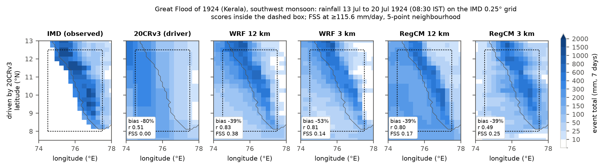
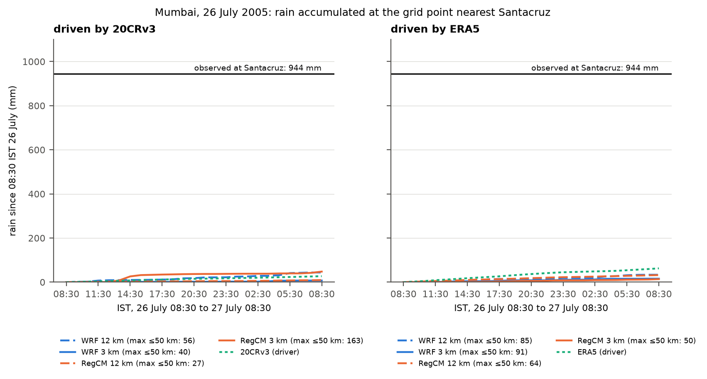

# Downscaling 20CRv3 over India: two extreme monsoon rainfall events, WRF and RegCM5

Can regional models driven by the **NOAA-CIRES-DOE 20th Century Reanalysis v3** (20CRv3),
which assimilates only surface pressure, reproduce extreme west-coast monsoon rainfall,
before 1950 as well as today?

| | E1: Kerala, July 1924 | E2: Mumbai, 26 July 2005 |
|---|---|---|
| Era | pre-1950 (only 20CRv3 exists) | 1981-2015 (20CRv3 and ERA5) |
| Drivers | 20CRv3 | 20CRv3, ERA5 (control) |
| Models | WRF 4.5, RegCM5 | WRF 4.5, RegCM5 |
| Resolutions | 12 km and 3 km | 12 km and 3 km |
| Scored against | IMD 0.25 deg daily rainfall, 7 days | IMD 0.25 deg daily rainfall, 4 days |

Nine model runs, all scored on the same IMD cells with the same metrics, against five
criteria committed before any run finished (`docs/metrics.md`, commit `260f8c9`).

**White paper:** [`docs/whitepaper/whitepaper.pdf`](docs/whitepaper/whitepaper.pdf)

## Results

1. **The 1924 flood is rebuilt from surface pressure.** 20CRv3's own rain is weak and
   smooth (bias -80%, pattern correlation 0.51). Every downscaled run puts a band of heavy
   rain along the Western Ghats: at 12 km both models reach r = 0.80-0.83 with a bias of
   -39%, and all four runs add skill over the driver. The modelled rain is still building
   two to three days after the observed peak, as is 20CRv3's own rain.
2. **The 2005 cloudburst is not reproduced** by any model, resolution or driver. Within
   50 km of Santacruz the largest 24 h total of any run is 163 mm, against 944 mm observed.
   ERA5-driven runs put their heavy rain on the Ghats crest rather than the coastal plain;
   20CRv3-driven runs are 58-84% too dry.
3. **3 km is not consistently better than 12 km.** WRF at 3 km rained less than WRF at
   12 km in every case; RegCM5 at 3 km raised the peaks but lost pattern correlation.


*E1, 13-20 July 1924, on the IMD grid: observed, 20CRv3's own rain, and the four downscaled runs.*


*E2: rain at the grid point nearest Santacruz in the 24 h in which 944 mm was measured.*

| Criterion | Outcome |
|---|---|
| H1 the models produce E2 with a good driver (ERA5, 3 km) | fail: best FSS 0.55 against 0.60, bias -39% |
| H2 the historical driver costs little (E2, 20CRv3 vs ERA5) | fail for all four model/resolution pairs |
| H3 downscaling adds value over the driver | pass for all E1 and E2-20CRv3 runs; fail for all E2-ERA5 runs |
| H4 3 km beats 12 km on extremes | 4 of 6 cases |
| H5 the pre-1950 event is reproduced (E1, 3 km) | pass, narrowly (RegCM5) |

Full tables: [`results/SCORECARD.md`](results/SCORECARD.md),
[`results/HYPOTHESES.md`](results/HYPOTHESES.md), `results/scores.csv`. The results in
figure order with captions: [`docs/story.md`](docs/story.md).

## A WRF bug found on the way

All three WRF runs first crashed in the Thompson microphysics (`mp_physics = 8`). In WRF
4.5 the rain-graupel collection tables have a graupel-density dimension of extent 1 when
hail-aware graupel is off, but are read at index 5: a wrong table entry in most columns and
a read past the end of the table in the heaviest rain with graupel. The lookups are the same
in WRF 4.5.1 to 4.7.1. Fix, reproducer and diagnosis: `patches/wrf45_thompson_fix.py`,
`tests/thompson_bounds/`, `docs/validation.md` item 21. With the fix all runs completed
without a stop.

## Repository

```
config/experiment.yaml        single source of truth: domains, dates, boxes, thresholds
namelists/                    generated from the config (never edited by hand)
  wps/ wrf/ regcm/            one per event x driver (x resolution for RegCM)
  GEOMETRY.md                 domain corners and nest indices
scripts/
  generate_namelists.py       config -> namelists
  check_namelists.py          every namelist key checked against the model source code
  budget.py                   compute + storage budget -> docs/budget.md
  download/                   20CRv3 (PSL OPeNDAP), ERA5 (CDS), IMD, RegCM static data
  preprocess/                 driver -> WPS intermediate files, driver -> RegCM ERA5-format files
  setup/                      HPC setup (RegCM5, Open MPI, netCDF builds), patched WRF build
  run/                        run_wps.sh, run_wrf.sh, run_regcm.sh, launch_all.sh, status.sh
  postprocess/                daily rainfall on the IMD grid (conservative remap)
  scoring/                    metrics, IMD date check, scorecard, criteria, figures
  diagnostics/                crash-address analysis (faultpc.py)
patches/                      WRF 4.5 Thompson fix, RegCM5 build/FNEST patches
tests/                        unit tests, end-to-end test on synthetic output, Thompson reproducer
docs/
  experiment_design.md        events, drivers, resolutions, model configurations, run matrix
  metrics.md                  verification method and the pre-registered criteria
  validation.md               every check made and every problem found, with fixes
  story.md                    the results in figure order, with captions
  whitepaper/                 LaTeX source and PDF of the white paper
  runbook.md, budget.md       how it was run; planned and measured cost
results/                      scores.csv, SCORECARD.md, HYPOTHESES.md, figures/
```

## Reproduce

```bash
conda env create -f environment.yml && conda activate twcr
pytest -q                                     # checks the code before any run
bash scripts/setup/hpc_setup.sh               # build RegCM5, download data, checks, smoke test, WPS
bash scripts/setup/build_wrf_thompsonfix.sh   # patched copy of the WRF 4.5 build
bash scripts/run/launch_all.sh                # the nine runs
bash scripts/run/status.sh                    # progress
for EV in E1_kerala1924 E2_mumbai2005; do
  python scripts/postprocess/extract_precip.py $EV --runs-root $RUN_ROOT
done
python scripts/scoring/score_all.py           # results/scores.csv, SCORECARD.md, HYPOTHESES.md
python scripts/scoring/story_figures.py --runs-root $RUN_ROOT
make -C docs/whitepaper                       # white paper PDF from results/
```

Step-by-step commands and failure handling are in `docs/runbook.md`.

## Key choices

- **Events are rainfall, not humid heat.** Gridded observations exist for 1924 rainfall
  (IMD from 1901) but not for 1924 temperature or humidity.
- **ERA5 control in 2005** separates model error from driver error.
- **12 km and 3 km**: parameterised convection and convection-permitting. One shared 12 km
  domain; one 3 km domain per event.
- **Both drivers go through one code path per model**: Python writes WPS intermediate
  files (no ungrib) and RegCM5 ERA5-format files (RegCM5 has no 20CRv3 reader).
- **No interior nudging** in either model.
- **COSMO-CLM is not included**: its source cannot go in a public repository
  (`docs/model_availability.md`).

## Cost

1,891 core-hours for the nine runs (two-thirds WRF) on a shared node; details in
`docs/validation.md` ("Measured cost") and the plan in `docs/budget.md`.

## Data and credits

20CRv3: Support for the Twentieth Century Reanalysis Project version 3 dataset is
provided by the U.S. Department of Energy, Office of Science Biological and Environmental
Research (BER), by the National Oceanic and Atmospheric Administration Climate Program
Office, and by the NOAA Physical Sciences Laboratory. ERA5: Copernicus Climate Change
Service. Rainfall: India Meteorological Department (Pai et al. 2014). Models: WRF (NCAR),
RegCM5 (ICTP).

## Citation and licence

Cite with [`CITATION.cff`](CITATION.cff). Code: MIT (see `LICENSE`). Documentation and
results: CC BY 4.0.
